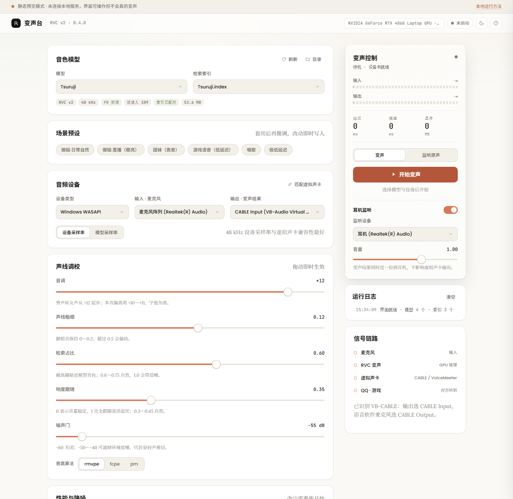
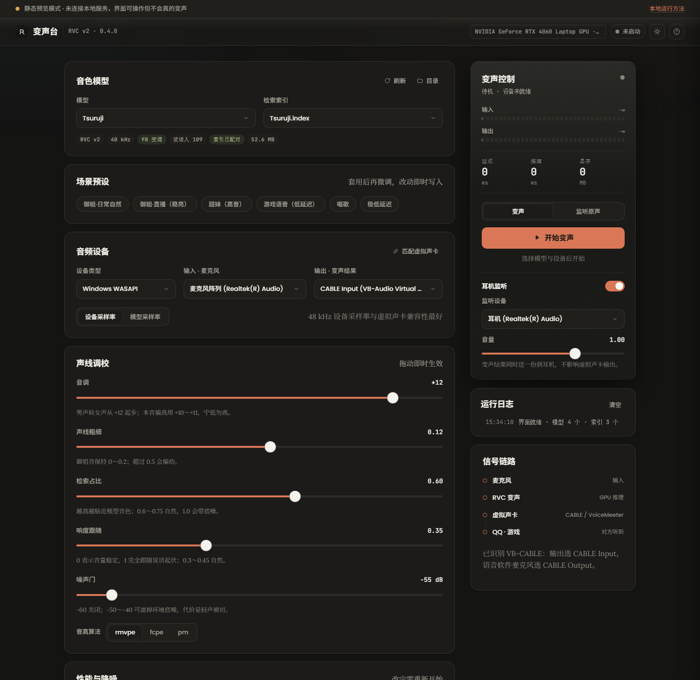

# 变声台 · RVC Voice Studio

一个跑在**你自己电脑上**的 RVC 实时变声控制台。暖米色 + 陶土橙的界面，深浅色可切换，主控区是一块液态玻璃卡片；模型、设备、调校、耳机监听都在一屏内完成。

- **在线预览（无后端，纯界面演示）**：<https://violet50411.github.io/rvc-voice-studio/>
- 真实变声需要本地启动服务（见下方「本地运行」）——声音与模型都留在本机，不上传。

| 浅色 | 深色 |
| --- | --- |
|  |  |

## 功能

- **模型**：下拉选择「音色模型 + 检索索引」，同名索引自动配对，读取 RVC 版本 / 采样率 / 说话人数 / 体积
- **场景预设**：御姐日常、御姐直播、甜妹、游戏低延迟、唱歌、极低延迟，一键套用后可继续微调
- **设备**：WASAPI / DirectSound / MME 任选，输入输出独立；「匹配虚拟声卡」自动识别 Voicemeeter 与 VB-CABLE 路由
- **调校**：音调、声线粗细、检索占比、响度跟随、噪声门、音高算法（rmvpe / fcpe / pm），热参数拖动即时生效
- **性能**：采样长度、淡入淡出、额外推理时长，输入/输出降噪
- **实时反馈**：输入/输出分段电平表（含峰值线）、算法延迟、单块推理耗时、显存占用
- **耳机监听**：把变声结果同时送一份到耳机，不影响虚拟声卡输出（不用再开 Windows「侦听」）
- **状态与日志**：带级别的日志、错误原因直出、`Ctrl+Enter` 开始/停止
- **无后端也能看**：静态托管时自动进入预览模式，界面可交互

## 本地运行

需要一台带 NVIDIA 显卡的 Windows 机器，以及一份可用的 RVC 引擎目录（即上游 [RVC-WebUI](https://github.com/RVC-Project/Retrieval-based-Voice-Conversion-WebUI) 的整合包或源码安装，目录里要有 `assets/`、`configs/` 和能跑起来的 Python 环境）。

```bat
:: 1. 把本仓库放在 RVC 引擎目录的同级，例如
::    E:\RVC\RVC-WebUI      ← RVC 引擎（含 assets、models、runtime）
::    E:\RVC\voice-studio   ← 本仓库

:: 2. 启动（脚本会自动找 ../RVC-WebUI 和 ../runtime/Scripts/python.exe）
scripts\start-windows.bat
```

手动启动：

```bat
set RVC_ROOT=E:\RVC\RVC-WebUI
python server\realtime_web.py
```

浏览器打开 <http://127.0.0.1:7898>。首次加载模型并预热 CUDA Graph 约 8～15 秒。

> `RVC_ROOT` 指向 RVC 引擎目录；`server/rvc_engine.py` 只是把上游的实时变声逻辑包成了可被 HTTP 调用的引擎，模型、底模、索引都留在 `RVC_ROOT` 下，不进本仓库。

## 路由怎么接

| 环节 | 选择 |
| --- | --- |
| RVC 输入 | 物理麦克风 |
| RVC 输出 | `CABLE Input`（VB-CABLE）或 `VoiceMeeter Aux Input` |
| QQ / 游戏 / OBS 的麦克风 | `CABLE Output`（VB-CABLE）或 `VoiceMeeter Aux Output` |
| 想听自己 | 打开右侧「耳机监听」 |

## 目录

```
voice-studio/
├─ index.html            界面结构
├─ style.css             设计令牌 + 组件样式（深浅色、液态玻璃、动效）
├─ app.js                状态机、API/WebSocket、电平表、预设、主题切换、预览模式
├─ server/
│  ├─ realtime_web.py    FastAPI + WebSocket 本地服务
│  └─ rvc_engine.py      变声引擎（设备、模型、音频流、耳机监听）
├─ scripts/start-windows.bat
└─ docs/                 截图
```

接口：`GET /api/bootstrap`、`POST /api/start|stop|hot|mode|monitor|voicemeeter|reload_devices|model_info|open_models`、`WS /ws`（10 Hz 推状态与电平）。

## 关于界面

- 色彩只用暖中性三族：陶土橙 `#D97757`、灰蓝 `#6A9BCC`、鼠尾草绿 `#788C5D`；无紫、无霓虹、无彩色光晕
- 液态玻璃只出现两处：吸顶栏与主控卡；其余表面为实色，避免整页毛玻璃的廉价感
- 字体：Poppins（界面）、Lora（说明文字）、JetBrains Mono（数字与日志），中文回退到思源/苹方/雅黑
- 动效：进场 480ms 一次性、悬停 160ms、主题切换只过渡颜色类属性 320ms；`prefers-reduced-motion` 下取消位移

## 说明

- 声音处理全部在本机完成；本仓库不含任何模型或语音数据，`.pth/.index` 请在本地自行放置（模型版权归其作者，请勿商用、勿冒充他人）。
- 上游 RVC 引擎为 MIT 协议；本仓库界面与服务层同样以 MIT 发布（见 [LICENSE](LICENSE)）。
- GitHub Pages 上只有静态界面（预览模式），任何变声能力都来自你本地启动的服务。
